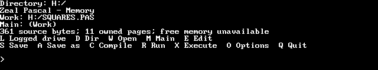
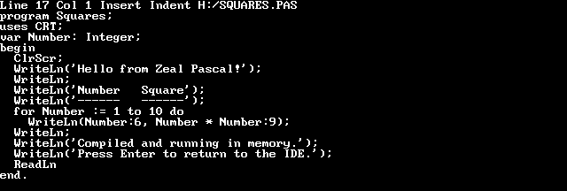
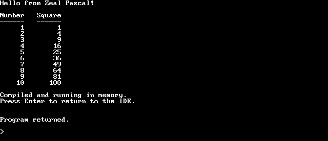
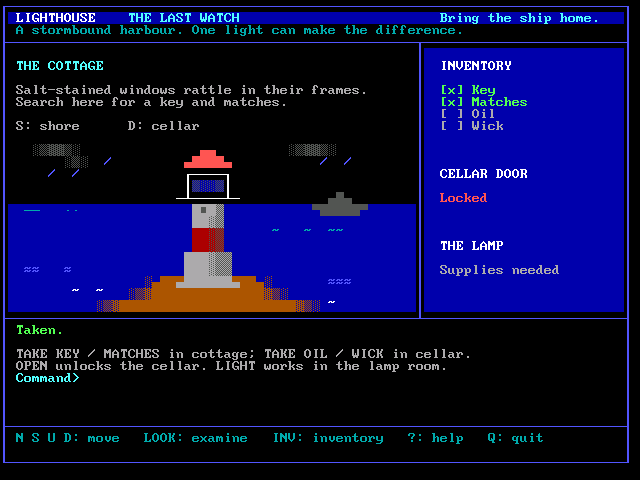
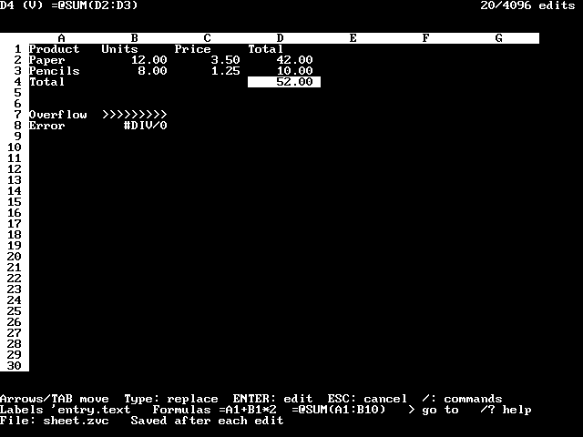

# Zeal Pascal

A native Pascal IDE, compiler and runtime for the MMU Zeal 8-bit Computer.
It follows the CP/M-80 Turbo Pascal 3 source-language style and adds native
Units, Word/LongWord, Zeal hardware access and ZOS system calls. Generated COM
files are native Zeal executables, not CP/M programs.

The IDE, compiler and your programs all run on the Zeal itself. Install the
prebuilt release below, write a first program, then continue with the
[user manual](docs/README.md).



The main menu keeps the Work file, compile mode and editor one key away.

## Download and install

Download `zeal-pascal-vVERSION.zip` from the
[latest release](https://github.com/zoul0813/zeal-pascal/releases/latest).
Use the release ZIP asset; GitHub's **Source code** archives do not contain the
built distribution.

1. Extract the ZIP. It contains `bin/` (the installation files) and `examples/`.
2. On your Zeal TF card, create `T:/bin/` and `T:/lib/` if needed. Copy
   `bin/zpascal.bin` from the ZIP into `T:/bin/`, and the contents of `bin/lib/`
   into `T:/lib/`. Put `examples/` wherever you keep your Pascal projects.
3. From ZShell, launch:

   ```text
   T:/bin/zpascal.bin
   ```

Without a bank-path argument, the launcher first looks for `lib/zpascal.zpl`
under the current working directory, then uses `T:/lib/zpascal.zpl` if the local
file is missing.

Keep the four ZPU files beside `zpascal.zpl`, and leave the bank file available
while using the IDE. Saved programs contain their selected runtime and Unit
code and do not need the IDE or ZPU files to run. Retain `ZVB.LIC` when
redistributing ZVB programs/assets.

For emulator TF-image setup or a complete source build (including emulator
compilation of CRT and ZVB), see
[Building and installing Zeal Pascal](docs/building.md).

## Write a first program

```pascal
program Hello;
begin
  WriteLn('Hello from Zeal Pascal')
end.
```

1. Answer the startup compiler-message prompt with **Y** or **N**. Press **W**, enter `T:/HELLO.PAS`, then press **E** and type the program.
2. Press **Ctrl-K**, then **D**, to return to the menu. The text stays in RAM.
3. Press **R** to compile and run it in Memory, then **S** to save the source.
4. For a standalone program press **O**, **C**, **Q**, then **C** to write a COM.

[Example applications](examples/README.md) include complete runnable programs,
source, input transcripts and instructions. [ZVB demos](examples/zvb/README.md)
cover graphics, sprites, sound, DMA and CRC32.

### From source to a running program

| Edit Pascal source | Compile and run in Memory |
| --- | --- |
|  |  |

### Example applications

| [Lighthouse](examples/lighthouse/README.md) | [Snake](examples/zvb/README.md) |
| --- | --- |
|  |  |

| [ZealCalc](examples/zealcalc/README.md) | [Calculator](examples/calc/README.md) |
| --- | --- |
|  |  |

Screens captured from native Zeal programs running in the Zeal emulator.

## Documentation

| Guide | Use it for |
| --- | --- |
| [IDE and editor](docs/ide.md) | Menus, every editor key, compile modes, saving and error lookup |
| [Pascal language](docs/language.md) | Syntax, types, operators, statements, routines, directives and machine access |
| [Runtime](docs/runtime.md) | Every predefined routine and variable, console input, files and memory |
| [Errors](docs/errors.md) | Compiler, runtime and I/O codes, with common causes |
| [CP/M TP3 compatibility](docs/compatibility.md) | Porting checklist, differences and unsupported features |
| [Units](docs/units.md), [CRT](docs/crt-library.md), [ZVB](docs/zvb-library.md), [ZOS](docs/zos-syscalls.md) | Libraries, screen, graphics, sound and system calls |

## Scope and limitations

The compiler, editor and runtime use native Zeal APIs and memory layouts.
Complete historical Turbo Pascal equivalence, compile-speed parity and all
physical-hardware behavior are not claimed. See [compatibility](docs/compatibility.md)
for deliberate differences and unsupported features, and [ZOS](docs/zos-syscalls.md)
for known pinned-kernel/emulator limitations. Compiler/runtime errors retain the
original-style source-location workflow; a modern debugger is not supplied.

Before physical use check [Zeal OS requirements and hardware acceptance](tests/hardware/README.md).
Emulator results do not establish physical display, audio, controller or serial
behavior. Programs must explicitly Close Pascal files to finalize buffered data.

## Development and testing

For source builds and emulator prerequisites, see the
[build guide](docs/building.md#fresh-compiler-and-pascal-units). Tests and
experimental targets are opt-in with `ZP_BUILD_TESTS=ON`; see
[test build options](docs/building.md#opt-in-test-targets).
The [testing guide](tests/README.md) describes the acceptance runner, fixtures,
CP/M reference prerequisites and result locations. The scheduled commands and
native prerequisites are defined in [the test plan](tests/acceptance/test-plan.json).

[GitHub builds and releases](docs/releasing.md) explains building a downloadable
distribution and releasing its exact build commit with a chosen version.

User documentation is maintained in `docs/`. Generated test output belongs in
`analysis/` or `build/`. Research material is maintainer-local and is not
distributed with the repository.
