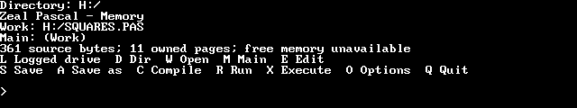
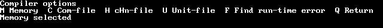
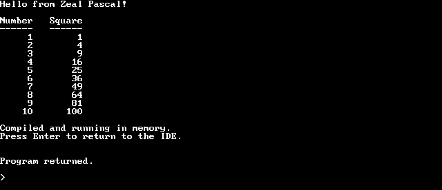
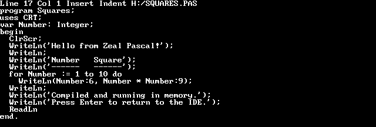

# IDE and editor guide

Zeal Pascal runs its editor, compiler and programs on the Zeal computer. The
editor and error-location workflow follow the CP/M Turbo Pascal style, with
native paths, files and console services. This guide covers the complete menu,
compilation modes, editor commands, search and error recovery.

## Contents

- [Install and start](#install-and-start)
- [First edit, run and save](#first-edit-run-and-save)
- [Main menu](#main-menu)
- [Work, Main and included source](#work-main-and-included-source)
- [Compilation modes](#compilation-modes)
- [Editor commands](#editor-commands)
- [Blocks](#blocks)
- [Find and replace](#find-and-replace)
- [Fields and cancellation](#fields-and-cancellation)
- [Errors and source lookup](#errors-and-source-lookup)
- [Saved programs and transfers](#saved-programs-and-transfers)

## Install and start

Download the [prebuilt release](../README.md#download-and-install), or follow
the [source-build guide](building.md). Install the matching
`zpascal.bin` launcher and `zpascal.zpl` bank file from one build. Keep
`SYSFILE.ZPU`, `CRT.ZPU`, `ZVB.ZPU` and `ZOS.ZPU` beside the bank file for
compilation; these are not extra runtime dependencies of an ordinary saved COM.
Keep ZVB licenses/attribution when redistributing programs containing that code.

From ZShell, the project TF layout starts with:

```text
T:/bin/zpascal.bin
```

An explicit bank path is also accepted:

```text
H:/zpascal.bin H:/zpascal.zpl
```

The launcher validates the bank container and requires it to remain available
for later compiler-bank reloads. A missing or incompatible file reports an
error rather than compiling with mixed assets. The environment needs working
page allocation/freeing and a supported text console. See
[board requirements](../tests/hardware/README.md) before hardware use.

At the opening message prompt, **Y** enables explanatory compiler messages;
**N** retains numeric diagnostics. Numeric errors remain usable if explanations
are unavailable. The main menu reports source/build information, the current
directory and owned RAM pages, and keeps the last successful compilation's line
count and code/data sizes. It does not invent free-memory or disk-capacity figures
the OS cannot query.

The IDE opens `T:/src/pascal/UNTITLED.pas` at startup when that file exists. If
the file or its directories are missing, it starts with an empty RAM buffer.

## First edit, run and save

1. Press **W**, type `T:/HELLO.PAS`, then Enter. A valid missing source starts
   an empty Work buffer. Loading does not create parent directories.
2. Press **E** and type a [first program](language.md#a-first-program).
3. Press **Ctrl-K**, then **D**, to return to the menu. Text remains in RAM.
4. Press **R**. In Memory mode the IDE compiles as needed and runs the program.
5. Press **S** to save the source. S writes the current Work path, including the default
   `T:/src/pascal/UNTITLED.pas` when startup opened an empty buffer. Use A to
   choose another path before saving.
6. For a standalone executable, press **O**, **C**, **Q**, then **C**. Run the
   resulting `T:/HELLO.COM` from ZShell.

Save source separately from compiling an executable. **A** saves the current
text under a different name; **W** selects/loads a file rather than renaming
unsaved text. Native source/executable saving can create missing parents.

## Main menu

Keys are case-insensitive and do not require Enter. Empty/unknown input, Space
or Enter redraws the main menu without changing files.



| Key | Action |
| --- | --- |
| **L** | Logged drive: enter `T`, `T:` or `T:/` to select an available native drive root; empty keeps current. Absolute Work and Main paths are unaffected. |
| **D** | Directory listing: enter a directory or final filename mask, such as `T:/src/*.pas`; empty lists current directory. |
| **W** | Work file: open/select a source path, default extension PAS. Resolve dirty Work first. |
| **M** | Main file: set the compilation root; empty clears Main so Work is the root. |
| **E** | Edit Work. Normal entry starts at the beginning; Ctrl-Q,P recalls the previous position. |
| **S** | Save Work, keeping the previous source version as BAK. |
| **A** | Save As: write current Work under a new source path, then adopt it. |
| **C** | Compile in the selected mode. |
| **R** | Memory mode: run a current build, compiling first if needed. Com-file mode: rebuild, publish and run the executable. cHn-file mode: compile, then explain that a Pascal caller must Chain the result. Unit-file mode: explain that a program must use the unit. |
| **X** | Execute an external native program by absolute or relative path, with no added extension, then return. Empty input, Escape or Ctrl-U cancels. Work, Main, editor state and the cached build are retained. No command-tail arguments are supplied. |
| **O** | Compiler options: mode, saved-program bounds and saved-error lookup. |
| **Q** | Quit, resolving dirty Work with save/discard/cancel. |

A dirty-file prompt uses **Y** to save, **N** to discard, and Escape/Ctrl-U to
cancel the pending action. A failed or canceled save/load retains the current
RAM text. Save As preserves cursor/text and adopts the new path only on success.
Saving replaces the prior BAK with the previous source version; treat BAK as one
backup generation, not version history. Use a separate backup for valuable work.

Directory masks support `*` (any byte sequence) and `?` (one byte) with native
filename case. Directories end in `/` in the listing. Space/Enter continues a long
listing; Escape/Ctrl-U stops it. Listing creates no files or paths. Drive
selection changes to the root of an available native drive; it does not remap
CP/M disk geometry.

## Work, Main and included source

There is one editable **Work** buffer. **Main** names the compilation root when
it differs from Work. Includes are disk files, not extra unsaved editor buffers.
Compiling another Main first saves dirty Work to its actual path, then reads
Main. Error navigation that must replace dirty Work also saves it first. A
failed save prevents the replacement/compile instead of silently using stale data.

When an error opens an included file as Work, Main remains the original root.
Repairing that include and pressing R saves it before recompiling Main from disk.
A self-contained Work program can compile/run entirely in RAM without first
saving source or writing a temporary executable.

Includes use `{$I path}` on a line of their own, with paths relative to the
containing file. There is one include level. See [include rules](language.md#compiler-directives-and-includes).
The editor accepts at most 127 source bytes per line and insertion column 128.
It rejects overflow rather than silently reflowing/truncating source.

## Compilation modes

Press **O**, choose a mode, then **Q** to return to the main menu.



| Option | Output and use |
| --- | --- |
| **M** Memory | Compile into owned RAM and run through R; no COM is published. |
| **C** Com-file | Publish a self-contained native `.COM`; it runs from ZShell. |
| **H** cHn-file | Publish a compact `.CHN` for a compatible saved Pascal caller's Chain. It cannot run from ZShell or directly through R. |
| **U** Unit-file | Compile a `unit` source to `.ZPU`. Compile with C, then use it from a program; it is not an executable. |
| **S** Start | In saved program modes, set hexadecimal code placement. Empty or zero chooses AUTO. |
| **E** End | In saved program modes, set hexadecimal memory end. Empty restores FBFF. |
| **F** Find runtime error | Reconstruct a source position from a reported hexadecimal PC; unavailable for Unit-file mode. |
| **Q** Return | Return to the main menu. |

**S** and **E** appear only in saved-program modes and take one to four hexadecimal
digits. Start 0 or a blank Start selects the automatic minimum; gaps before code
are zero-filled. End must lie in `CFFF`..`FBFF` with room for the program and at
least 2 KiB of stack, and a blank End restores `FBFF`. Program startup sets
`StackPtr` to End+1. Invalid input keeps the old value and asks again; Escape or
Ctrl-U cancels the field. Memory mode always uses automatic Start and `FBFF`.

The displayed ranges use platform bounds, or last-compiled program bounds after a
successful compile; the compiler rechecks actual code, data and stack needs on
every compilation. Changing modes or relevant bounds invalidates the
cached build. It does not save source. The legacy Options **P** parameter-tail
command is not provided.

Memory Run uses the compiled image in place. Typed-constant mutations persist
on another Run until recompilation; do not assume a fresh activation resets all
initialized storage. Saved mode recompiles/publishes on R and releases transient
compiler state before launching the disk executable. Disk compilation uses
private temporary storage and trades disk I/O for RAM capacity.

Output names follow Main when present, otherwise Work. Source maps remain
private compiler state; no map sidecar is required for saved runtime lookup.
A successful Compile/Save/Run returns directly to the menu prompt; Enter redraws
the full menu. Errors retain an acknowledgment and source-recovery workflow.



This program compiled and ran in Memory without publishing a COM file. Its
output remains visible after returning to the IDE prompt.

## Editor commands

`Ctrl-K,D` means hold Control and press K, then press D. The second key of a
prefix command can be the letter or its control-key form. The 45 commands below
are the complete editor binding inventory. **Ctrl-U** is an additional abort key.

These physical keys are shortcuts for the same operations:

| Physical key | Same as |
| --- | --- |
| Left, Right | Ctrl-S, Ctrl-D |
| Up, Down | Ctrl-E, Ctrl-X |
| Home, End | Ctrl-Q,S and Ctrl-Q,D |
| Insert | Ctrl-V, toggle insert/overwrite |
| Page Up, Page Down | Ctrl-R, Ctrl-C |
| Backspace | Delete left |
| Delete | Delete under cursor, Ctrl-G |

An actual Ctrl-H byte moves left without deleting.

### Cursor movement

| Key/command | Action |
| --- | --- |
| Character left, Ctrl-S | Move one column left, stop at column 1; no cross-line movement |
| Left alternative, Ctrl-H | Same non-destructive operation; not DEL |
| Character right, Ctrl-D | Move one column right, including virtual space; scroll horizontally within limit |
| Word left, Ctrl-A | Move to the previous word boundary; crossing from line start first reaches preceding line end |
| Word right, Ctrl-F | Move to the next word start; from line end cross to the next line |
| Line up, Ctrl-E | Move up one logical line, retain column, scroll when required |
| Line down, Ctrl-X | Move down one logical line, retain column, scroll when required |
| Scroll up, Ctrl-W | Move viewport toward file start; retain source position until the active bottom constrains it |
| Scroll down, Ctrl-Z | Move viewport toward file end; retain source position until the active top constrains it |
| Page up, Ctrl-R | Move back one page with a displayed overlap line, bounded by file start |
| Page down, Ctrl-C | Move forward one page with a displayed overlap line, bounded by file end |
| Line start, Ctrl-Q,S | Go to logical column 1 |
| Line end, Ctrl-Q,D | Go immediately after the last stored character, excluding trailing blanks |
| Screen top, Ctrl-Q,E | Go to top active text line |
| Screen bottom, Ctrl-Q,X | Go to bottom active text line |
| File start, Ctrl-Q,R | Go to first character |
| File end, Ctrl-Q,C | Go to final insertion position, including final empty line if present |
| Block start, Ctrl-Q,B | Go to begin marker even when block is hidden or only begin is defined |
| Block end, Ctrl-Q,K | Go to end marker even when block is hidden or only end is defined |
| Previous position, Ctrl-Q,P | Restore remembered pre-find or pre-end-edit source position |

### Inserting and deleting

| Key/command | Action |
| --- | --- |
| Insert/overwrite, Ctrl-V | Toggle insertion versus replacement of the byte under cursor |
| Insert line, Ctrl-N | Insert a newline at cursor without moving cursor |
| Delete line, Ctrl-Y | Remove current line and its separator; move to column 1 on following line |
| Delete to line end, Ctrl-Q,Y | Delete from cursor to end of current line, not the newline |
| Delete right word, Ctrl-T | Delete the right-hand word fragment; may remove a line break |
| Delete under cursor, Ctrl-G | Delete the byte under cursor; do not join lines at EOL |
| Delete left, Backspace key (DEL byte) | Remove previous byte and move left; at line start join with preceding line |
| DEL alternative | No second key is bound by default; the Backspace key performs Delete left |

### Block commands

See [Blocks](#blocks) for selection rules.

| Key/command | Action |
| --- | --- |
| Mark begin, Ctrl-K,B | Set begin marker at cursor |
| Mark end, Ctrl-K,K | Set exclusive end marker at cursor |
| Mark word, Ctrl-K,T | Mark word containing cursor, or the preceding word when cursor is outside a word |
| Hide/show block, Ctrl-K,H | Toggle visible block marking; hidden block disables copy/move/delete/write, not jumps |
| Copy block, Ctrl-K,C | Insert a copy at cursor; retain original; markers enclose new copy |
| Move block, Ctrl-K,V | Remove selected bytes and insert at destination; markers follow moved text |
| Delete block, Ctrl-K,Y | Remove marked visible range; no global undo |
| Read block, Ctrl-K,R | Insert named file at cursor and mark inserted range |
| Write block, Ctrl-K,W | Write selected bytes without changing text/markers; confirm overwrite |

### Leaving, formatting and searching

| Key/command | Action |
| --- | --- |
| End edit, Ctrl-K,D | Return to main menu, keep unsaved buffer in RAM |
| Auto tab, TAB/Ctrl-I | Insert spaces to next word-start column on preceding line |
| Auto-indent, Ctrl-Q,I | Toggle indentation copied on Return; update status indicator |
| Restore line, Ctrl-Q,L | Restore the current line's before-edit contents while cursor has not left it |
| Find, Ctrl-Q,F | Search; see [Find and replace](#find-and-replace) |
| Find/replace, Ctrl-Q,A | Search and conditionally replace; see [Find and replace](#find-and-replace) |
| Repeat search, Ctrl-L | Repeat preceding find or find/replace with remembered inputs/options |
| Quote control, Ctrl-P | Insert next control byte as data instead of executing it |

### Editing behavior

The first screen row shows line, column, Insert or Overwrite, the Indent indicator
when enabled, and the Work filename.



Word commands treat space, line boundaries and `< > , ; . ( ) [ ] ' * + - / $` as
delimiters. These are editor words: they do not follow the Pascal lexer, and a
literal TAB or other control byte is part of a word. Ctrl-Z cannot be quoted into
source because it marks the legacy end of file; write `#26` in Pascal instead.

Normal entry is Insert mode with auto-indent enabled. Movement beyond a short
line enters virtual space without adding stored blanks. Inserting there adds
the necessary spaces. Automatic Tab follows word-start columns on the preceding
line; it is not a fixed eight-column TAB and inserts spaces. Quoted/imported
TAB bytes remain literal control bytes, displayed by their highlighted control
letter. Source save normalizes line endings and trailing spaces as described in
[the language guide](language.md#source-text-and-tokens).

Restore-line is local undo only: the saved before-image is discarded after
leaving the line, and cannot recover a deleted line/block. There is no global
undo history, macro recorder, breakpoint interface or modern debugger.
Ctrl-U interrupts the active editor operation; Escape acknowledges it.

## Blocks

The begin marker is inclusive and end marker exclusive. Both ordered markers
and visible highlighting are required for copy, move, delete and write. Missing,
empty or inverted selections do not expand into a destructive default selection.
Hiding a block disables those operations but does not disable marker jumps.

Copy snapshots the range. Move into its own selection is a no-op. A completed
copy, move or file read marks the resulting block. Read inserts a named source
file at the cursor; Write exports the selected bytes without changing Work.
Block writes confirm replacement of an existing target. **N** retains that file
and returns to filename entry; **Y** permits replacement. Escape cancels, and
Ctrl-U interrupts with acknowledgment. Allocation or line-overflow failure
retains the existing editor text.

## Find and replace

**Ctrl-Q,F** prompts for a search string and options. **Ctrl-Q,A** adds a
replacement field; an empty replacement deletes matches. Fields are limited to
30 bytes. Empty Find cancels and retains previous search history. **Ctrl-L**
repeats the preceding operation and its options.

| Option | Meaning |
| --- | --- |
| **B** | Search backward. |
| **G** | Start globally at beginning/end as appropriate; replacement visits the text. |
| **U** | Ignore ASCII letter case. |
| **W** | Match whole editor words. |
| Decimal digits | Occurrence/replacement count; digits anywhere in the options form one 16-bit count that wraps on overflow. Zero means the default single match. |
| **N** | Replacement without asking Y/N for every match. |

A forward match leaves the cursor after the text; a backward match leaves it at
the start of the text. A replacement count includes matches you answer **N** to.
Global replacement visits every match even when a count is given.

Flags can be combined. Unknown option bytes are ignored; they do not enable
regular expressions. Ctrl-P quotes control data in fields. Quoted Ctrl-A is a
single-byte wildcard in a search pattern and literal data in a replacement.
Quoted CR/LF boundaries normalize to one source newline. Replacement does not
search the text it just inserted. Rejected/canceled later replacements retain
earlier accepted edits. Whole-word delimiters follow the editor's word rules,
not the full Pascal identifier lexer. Global Find selects the match rather than
reproducing the original CP/M binary's scan-to-EOF defect.

## Fields and cancellation

Filename, search and option fields support cursor/word movement, Home/End,
Backspace/Delete, insert/overwrite, Ctrl-P quoting, and Ctrl-Y clear. Ctrl-F at
the end recalls the prior field's text where that field keeps history. Enter
accepts; Escape cancels. Compiler-address fields accept hexadecimal input without
wrapping invalid values.

Ctrl-U cancels compilation, source/Save As/block output and executable publication
between safe chunks. Queued ordinary typing is retained within the bounded IDE
queue; filling it stops the operation instead of silently dropping text. Escape
acknowledges the interruption. This IDE key is distinct from a running Pascal
program's Ctrl-C behavior, which depends on CBreak and compiler directives.

## Errors and source lookup

Compilation stops at the first error, preserving its source file, line/column
and position. Acknowledge as prompted, then repair the selected source. A failed
or canceled compilation leaves nothing to run; the next **R** compiles again.
Saving can fail independently of compilation.


Here `Number := ;` is missing an expression. Pressing Escape opens the editor at
the reported source position:


Memory runtime errors and I/O errors report their category, code and source
coordinate and return through the IDE's error workflow. Escape opens the source
position. A runtime error inside imported Unit code is mapped only when its
source matches what was compiled; missing/changed source leaves Work untouched.

For a cold saved-program error:

1. Record its hexadecimal PC and error category/code.
2. Select the correct Main/Work source and saved compilation mode.
3. Restore the compiler version and Start/End settings used to build it.
4. Choose **O → F**, enter one to four hexadecimal PC digits, then Enter.
5. When found, Escape opens the actual source/include at that position.

F reconstructs mapping by compiling source; it works in a new session without
the original COM/map file. Changed source or build settings can change code
positions, so an arbitrary PC is not authenticated by its digits alone. CHN
source lookup uses its correct owning program settings. Pascal overlay lookup
is unavailable. See [diagnostics](errors.md) for code meanings.

## Saved programs and transfers

A saved COM includes its chosen runtime, selected Unit fragments and globals.
It needs neither the IDE nor ZPU files for execution. File paths used by the
program remain relative to its native working directory unless absolute.

A CHN omits the ordinary executable runtime/globals and requires a matching
private-runtime identifier. Build caller as COM and replacement as CHN with
matching explicit Start/End and compatible leading global declarations:

```pascal
var NextProgram: File;
begin
  Assign(NextProgram, 'T:/NEXT.CHN');
  Chain(NextProgram)
end.
```

This listing is the caller's transfer pattern, not a complete demonstration of
shared globals. Successful Chain does not return; mismatched/private stale CHNs
are rejected. Each member should pair its own CrtInit/CrtExit: a replacement
cannot restore a preceding member's terminal snapshot.

`Execute(F)` replaces a saved caller with a native executable and does not return
on success. The current loader accepts nonempty images below 48 KiB; not every
native executable is a Pascal image. A failed unchecked transfer returns for
IOResult handling and preserves the caller's logical file associations. A saved
caller run through R returns to the IDE when the replacement exits.

The main-menu **X** action is different: it uses native preserve-exec to return
to the IDE, restores its directory and console and reports the child's status.
It does not clear Work. For programmatic child arguments/returning execution or
raw OS services, see [ZOS](zos-syscalls.md).
