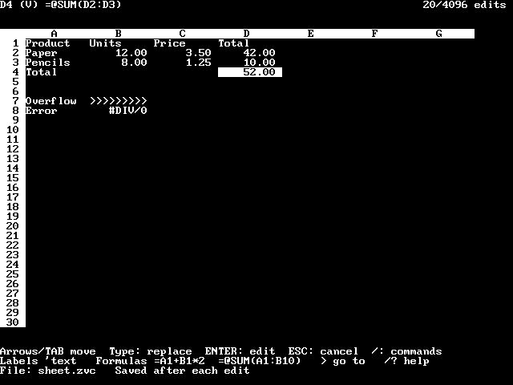
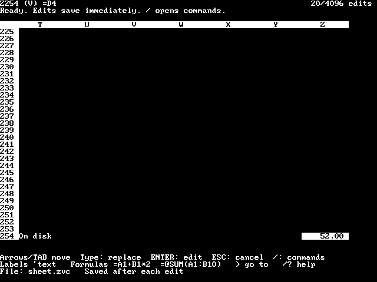

# ZealCalc

A VisiCalc-inspired spreadsheet written entirely in Zeal Pascal. The UI uses
`Crt` and `ZOS` on the ZVB 80x40 text screen. Two Pascal overlays validate/save
the sheet and calculate its viewport. This follows the companion-program pattern of Measure Lab, keeping the UI plus one
backend resident within the machine's address space.
It is a new example, not a VisiCalc port or file-format emulator.

Copy this entire folder to Zeal. Change into it, then run:

```text
./zealcalc.bin
```

Keep **zealcalc.bin, zcsheet.bin and zccalc.bin together** and run from that directory.
The default sheet is `sheet.zvc`; pass another path for another sheet:
`./zealcalc.bin budget.zvc`. Missing sheets are created automatically; existing
files are validated without truncation. The linked executables need no Units at
run time. Use native 80x40 text mode. Quit with `/Q`, then Y.

## Working with cells

The monochrome status/prompt/entry lines, inverse borders, lettered columns and
slash commands recall VisiCalc. Labels align left and values right. Seven
columns and thirty rows are visible; addresses span A1..Z254.

- Arrows move the selection and scroll at the viewport edge; TAB moves right.
- Type to replace a cell. ENTER or `/E` edits its existing source.
- ENTER commits; arrows or TAB commit and move. ESC cancels. Backspace/Delete
  removes the last character. The entry editor appends at the end.
- `>` goes to an address (`/G` is a convenience alias). `/B` blanks a cell.
- `/?` shows a short hint. The limit and formula reference is below.

Edits save immediately. There is no separate Save command or unsaved sheet state.
Enter labels directly, or begin with an apostrophe to force a label (`'2026`).
Enter decimal numbers directly. Begin formulas with `=`:

```text
A1: Product     B1: Units     C1: Price     D1: Total
A2: Paper      B2: 12        C2: 3.50      D2: =B2*C2
A3: Pencils    B3: 8         C3: 1.25      D3: =B3*C3
A4: Total                                 D4: =@SUM(D2:D3)
```

D2 displays 42.00, D3 10.00 and D4 52.00. Change B2 to 20: D2 becomes 70.00
and D4 becomes 80.00. Quit and reopen the same file to retain the sheet.

Formulas support case-insensitive references, decimal literals, parentheses,
unary signs, `+ - * /` with ordinary precedence, and `@SUM(A1:B10)` with an
inclusive rectangular range. Blank cells and labels contribute zero. Off-screen
references are fetched from disk. Calculations retain Pascal Real precision;
the display rounds to two decimal places. A numeric result too wide for the
nine-character field shows `>>>>>>>>>`, never a truncated number. Long labels
are clipped; ENTER opens the full source in the entry line.

Errors propagate through references: `#SYNTAX`, `#REF`, `#DIV/0`, `#RANGE`,
`#CYCLE`, `#DEPTH`, `#LIMIT`. Invalid formulas are saved so they can be corrected.
Magnitudes must not exceed 1,000,000,000; nonzero divisors must be at least
0.000000001 in magnitude. Each SUM may visit at most 256 cells. Dependencies
have eight frames, and parser recursion has sixteen levels, counting operator,
parenthesis and unary-sign calls across dependencies. Each displayed result may
visit at most 2048 cells, including repeats; exceeding that budget yields
`#LIMIT`. These bounds constrain both stack use and evaluation work.

## Bounded memory and disk storage

There is no file-backed `mmap` in the current Pascal/Zeal OS interface. ZOS MAP
maps physical hardware/RAM pages, not disk files; it provides no demand paging.
ZealCalc uses an explicit bounded working set instead:

| Structure | Size | Lifetime |
| --- | ---: | --- |
| 254 row-head record indices | 508 bytes | Worker invocation |
| Eight formula frames | 560 bytes | Calculator invocation |
| Shared disk record | 70 bytes | Worker invocation |
| One selected/rendered cell | 75 bytes | UI |

These are the principal data structures, not executable code, Units, other
fixed workspaces or stacks. No RAM structure grows with populated cells or edits.
The UI retains no whole-sheet or whole-viewport cell array. It reads the selected
source and old/new selection fields from a disk viewport file. Scrolling and edits
invoke the worker once to rebuild the viewport; movement within it does not
recalculate the sheet. The UI image remains preserved while the save overlay runs and tail-replaces
itself with the calculator. The calculator returns to the UI. Before evaluation,
it reserves 2,496 bytes for guarded CPU calls using Pascal's `RecurPtr`; active parser
workspaces use the separate bounded recursion area.

The Pascal typed `.zvc` file has a four-byte count/component-size header, one
70-byte signature record and 70-byte edit records. Each
changed entry stores row, column, previous record in that row's history, source
string and additive checksum. Blank is a stored empty string, so an older value
cannot reappear after eviction or reopening. Unchanged entries use no edit
capacity. Each worker streams and validates the file to reconstruct row heads;
it does not load the cells. Lookups walk that row's history, newest first.
Values are recomputed, so edits
cannot leave stale dependency totals. Long histories can make refresh slower.

A file permits **4096 changed entries**, including replacements and Blank, and
occupies at most **286,794 bytes**. Cells hold at most 63 source characters. A full
file remains viewable. There is no undo, compaction, import/export, row/column
insertion, copy, relative-reference rewriting or VisiCalc file compatibility in
this example. Use another file for a new sheet; back up sheets with normal file
copying tools.

Each accepted edit is written completely, closed and reopened before being
reported saved. This is not a power-loss transaction guarantee; there is no sync
API here. An incomplete committed record, invalid address/chain, nonprintable source or
checksum failure stops opening the sheet without discarding bytes. The typed
file header determines the committed record count; extra uncommitted bytes are
not sheet entries. The additive checksum
detects simple corruption, not deliberate tampering. A worker/close failure may
occur after an edit has reached disk; restart and inspect rather than replay it
blindly. Keep backups, free disk space and a single writer per sheet.

## Scratch files and worker lifecycle

`zc.req` and `zc.view` are private, fixed-size request and viewport files in the
current directory. Startup refuses pre-existing files with those names. Normal
exit removes only the files reserved by this session. After a forced interruption,
inspect and remove stale scratch files before restarting; keep the `.zvc` sheet.
Do not run two ZealCalc sessions in the same directory. No filesystem locking or
exclusive-create API is available in the current ZOS interface.

The worker validates request coordinates, lengths and source characters before
editing. It marks its response complete only after writing the entire viewport;
the UI checks native execution status and the response header. Failed requests
stop the UI, preventing blind retries of an edit that may already have committed.
Worker exit codes identify disk/format errors or request failures; code 6 means
checksum failure, and 31–37 a backend-protocol I/O or
validation failure. The sheet remains on disk for inspection/restoration.

## Building and verification

In the native IDE, compile **all three** programs: `zealcalc.pas`, `zcsheet.pas`, and
`zccalc.pas`, using **O → C → Q**, then **C**. Keep `include` beside them. Install matching CRT.ZPU,
ZOS.ZPU and SYSFILE.ZPU beside the compiler bank file. The resulting COM files use
the same native image format as the distributed `.bin` files; use the filenames
`zealcalc.bin`, `zcsheet.bin`, and `zccalc.bin` together. See the [Unit guide](../../docs/units.md).
Run the UI from ZShell: its worker requires another native execution level, which
may not be available when the UI is already running inside the IDE's RAM worker.

From the repository root:

```sh
make
python3 tests/acceptance/test-zealcalc.py --package
```

In a worktree outside the usual Zeal directory layout, set `ZP_ZEAL_ROOT` to the
existing `/Users/higginsd/Projects/zeal` directory for Make and the test command.
This locates the installed native emulator and local ZDE ROM.

The focused acceptance check compiles the exact three programs and their actual
includes on the unmodified emulator. It tests the real backend pipeline with
formula and storage fixtures and replays keyboard entry, cancel, navigation,
Blank, reopening and corrupt-file
refusal. `--package` refreshes all three binaries, native screen captures and the
hash manifest only after those checks pass. Physical hardware qualification and
historical VisiCalc equivalence are separate from emulator acceptance.

## Emulator screenshots

Captured from the actual ZVB character/attribute planes, font and palette:




